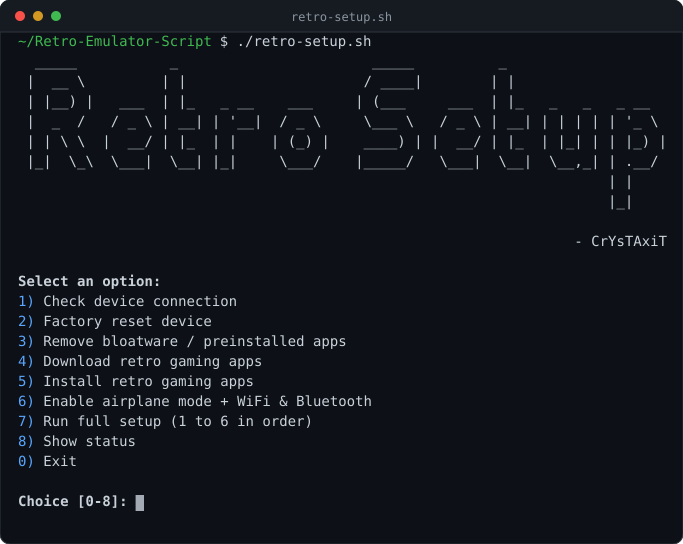

<p align="center">
  
</p>

<h2 align="center">Retro Emulator</h2>

<p align="center">
  Bash script to turn your old Android phone into a Retro Gaming Emulator.
</p>

Everything runs over ADB from your computer — a menu walks you through wiping
the phone, stripping out the preinstalled apps, installing the emulators and
locking the radios down so the device behaves like a dedicated handheld.

### Requirements

On your computer:

- `bash`
- [Android platform-tools](https://developer.android.com/tools/releases/platform-tools) — provides `adb` and `fastboot`, both must be on your `PATH`
- `curl`

On the phone:

- **USB debugging** enabled in Developer options, and the USB debugging prompt accepted
- An **unlocked bootloader** — only needed for the factory reset option (2)

### Usage

```bash
git clone https://github.com/SarveshP16/Retro-Emulator-Script.git
cd Retro-Emulator-Script
chmod +x retro-setup.sh
./retro-setup.sh
```

<p align="center">
  
</p>

Pick an option from the menu:

| # | Option | What it does |
|---|--------|--------------|
| 1 | Check device connection | Confirms ADB sees the phone, prints manufacturer and model |
| 2 | Factory reset device | Reboots to the bootloader and runs `fastboot -w` (asks twice first) |
| 3 | Remove bloatware | Uninstalls known preinstalled apps for the current user |
| 4 | Download retro gaming apps | Fetches the APKs into `./apks` |
| 5 | Install retro gaming apps | Installs every APK in `./apks` with all permissions granted |
| 6 | Install games / BIOS files | Copies `games/` and `bios/` onto the phone |
| 7 | Enable airplane mode + WiFi & Bluetooth | Kills mobile data, keeps Wi-Fi and Bluetooth |
| 8 | Run full setup | Runs 1 to 7 in order, stopping at the first failure |
| 9 | Show status | Reports downloaded APKs, device info, installed emulators, games on device, radio state and leftover bloatware |
| 0 | Exit | |

### Apps installed

| App | Version | Package |
|-----|---------|---------|
| [RetroArch](https://www.retroarch.com/) | 1.22.2 | `com.retroarch.aarch64` / `com.retroarch` |
| [PPSSPP](https://www.ppsspp.org/) | 1.20.4 | `org.ppsspp.ppsspp` |
| [Daijishou](https://github.com/TapiocaFox/Daijishou) | 1.5.0 | `com.magneticchen.daijishou` |

RetroArch comes in a 32-bit and a 64-bit build; the script reads
`ro.product.cpu.abi` off the phone and downloads the matching one. With no
device attached it falls back to the 64-bit build. Versions are pinned at the
top of the script if you want to bump them.

No games or BIOS files are downloaded — bring your own, then use option 6 to
copy them across.

### Games and BIOS files

Option 6 copies two local folders onto the phone. Create them (option 6 makes
them for you on first run) and drop your files in:

```
games/
  snes/        -> /sdcard/Roms/snes
  psp/         -> /sdcard/Roms/psp
  gba/         -> /sdcard/Roms/gba
bios/          -> /sdcard/RetroArch/system
```

One folder per system under `games/`; the folder name becomes the platform
folder on the device. BIOS files go flat in `bios/`, which lands in RetroArch's
system directory where the cores look for them.

Before copying, the script totals the size and checks it against the free space
on the phone, then asks to confirm. Afterwards, point Daijishou at
`/sdcard/Roms/<platform>` as a library path to see your games.

If your collection lives elsewhere, point the script at it for a single run:

```bash
ROMS_DIR=/media/usb/roms BIOS_DIR=~/bios ./retro-setup.sh
```

Both folders are in `.gitignore`, so nothing you drop there gets committed.

### Notes

**Bloatware removal is reversible.** Option 3 uses
`pm uninstall -k --user 0`, which drops the app for the current user but leaves
the APK on `/system`. Nothing is deleted from the system partition, so a
factory reset brings everything back. To restore a single app:

```bash
adb shell cmd package install-existing com.example.app
```

The list covers around 40 common Google, Meta, Samsung, Xiaomi, Oppo and Vivo
preloads and lives in the `bloatware` array near the top of the script — edit
it to match your phone. Packages that aren't installed are skipped, and
protected system apps that refuse to uninstall are reported and skipped too.

**Why airplane mode?** Option 6 enables airplane mode to cut the cellular
radio (no mobile data, no calls, less battery drain), then turns Wi-Fi and
Bluetooth back on so you can still download content and pair a controller.

**Factory reset wipes everything.** Option 2 erases all user data via
`fastboot -w` and needs an unlocked bootloader. It asks for confirmation twice
and can be skipped if you only want the rest of the setup. Back up anything you
care about first.

### License

[MIT](LICENSE) — © 2026 Sarvesh Pandit.

This covers the script and its assets only. RetroArch, PPSSPP and Daijishou are
downloaded from their official sources at runtime and keep their own licenses;
nothing is redistributed here.
